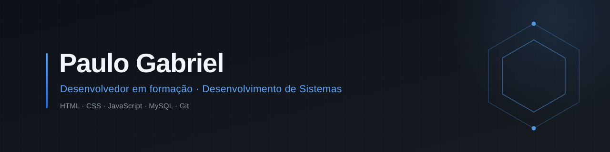

## Sobre

Sou estudante do ensino médio técnico em Desenvolvimento de Sistemas na ETEC Valdivino
Antonio Marcusso. Uso este GitHub para registrar o que estou construindo: projetos da
escola, exercícios e experimentos próprios.

Meu foco atual é desenvolvimento web — HTML, CSS, JavaScript e banco de dados — e estou
começando os estudos em cibersegurança. Prefiro entregar poucos projetos bem documentados
a muitos repositórios pela metade.

## Stack

**Front-end**

**Banco de dados**

**Ferramentas**

**Estudando**

## Projetos

**[Relatorio-ACBr](https://github.com/pgabriel-dev/Relatorio-ACBr)**
Estudo sobre geração de relatórios e automação comercial usando o framework ACBr.
`ACBr` `Relatórios` `Estudo de caso`

## Atualmente

- Aprofundando JavaScript e modelagem de banco de dados
- Construindo projetos práticos para compor portfólio
- Iniciando os fundamentos de cibersegurança

## Contato

- LinkedIn — [Paulo Gabriel](https://www.linkedin.com/in/SEU-PERFIL)
- E-mail — seu.email@exemplo.com
- Instagram — [@_pgxzt](https://instagram.com/_pgxzt)
